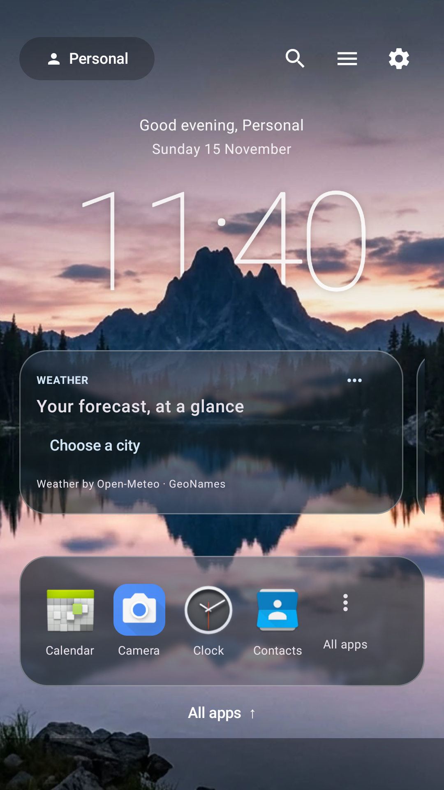
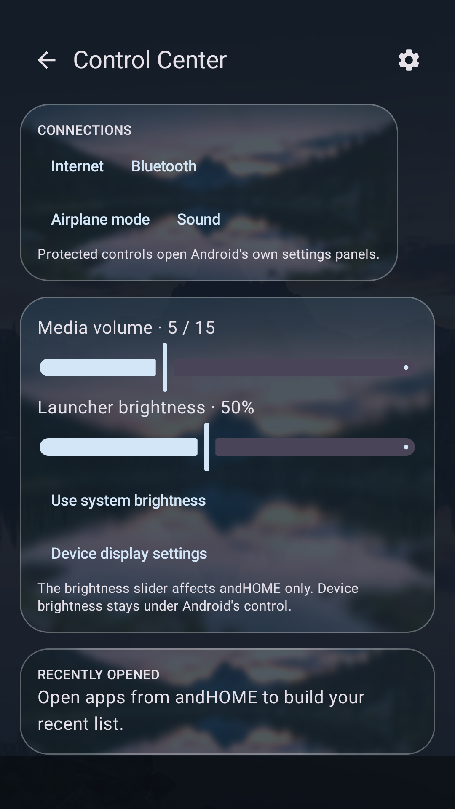

# andHOME

**tvHOME's Night Scenes experience, rebuilt as a native Android smartphone launcher.** Android 10+ (`minSdk 29`), Kotlin / Jetpack Compose, application ID `app.andhome.launcher`.

Version 0.2 replaces the plain foundation screen with tvHOME's layered landscapes, oversized clock, glass panels, horizontal widget shelf, profile pill and translucent app dock. Portrait layouts, touch gestures and phone settings replace TV remote navigation. The existing tvHOME project remains unchanged.

<p> </p>

Download the phone test APK from [Releases](https://github.com/pandxsah/andHOME/releases).

## What works

- Night, Golden Hour, Waterline, Fog and Rainforest Dawn scenes using the original background/foreground/glass assets, with preserved upstream notices. Optional slow motion, static mode, custom local wallpaper and Classic look.
- Default HOME role, installed app drawer, search and explicit app launching. Swipe up on the clock area for apps, down for Control Center.
- Home app grid, scrolling dock with capacity 3–7, pinning, reordering, renaming, hiding, custom image icons and app info. Shrinking the dock moves overflow to home.
- Horizontal home widget shelf: weather, media player, football scores, prayer times, battery and launcher recent apps. Add/remove/reorder cards in Customize home; hold a card to remove it.
- Weather city search, current conditions and tomorrow's forecast via Open-Meteo. No GPS permission. Cached data and offline/error states.
- Music metadata/artwork and supported playback controls through user-approved notification access. Notification messages are not read or saved.
- Optional ESPN football feed with league selection; optional AlAdhan prayer times for the selected city (Muslim World League method). These integrations depend on provider availability.
- Phone Control Center: Internet/Bluetooth/airplane/sound settings, media volume, launcher brightness and recent apps.
- Up to eight local launcher profiles with separate layouts, scenes, app names/icons, widgets and settings.
- Versioned JSON backup/restore with file picker, full validation before replacement and explicit replace confirmation. Photos, custom icons and recent app history are excluded.
- Dark/light/system themes, grid settings and migration from version 0.1.
- GitHub release checks and browser download handoff; on-device crash report shown after a crash, with explicit copy/dismiss controls.

This is a development build, **not complete tvHOME feature parity**. See the [port matrix](docs/PORT_MATRIX.md) for the remaining integrations and Android-specific differences.

## Build

JDK 17, Android SDK platform 36, build-tools 35.0.0. Set `JAVA_HOME` / `ANDROID_HOME`, or set `sdk.dir` in an untracked `local.properties`.

```powershell
.\gradlew.bat assembleDebug testDebugUnitTest lintDebug assembleDebugAndroidTest
```

On macOS/Linux use `./gradlew` (or `sh ./gradlew`). Gradle 8.13, AGP 8.13.2, Kotlin 2.2.21. First build needs Internet. Debug APK: `app/build/outputs/apk/debug/app-debug.apk`.

Select a **phone/emulator** explicitly with `ANDROID_SERIAL` before running `connectedDebugAndroidTest`. Use the stock launcher as default during automated activity tests; verify andHOME's default-HOME role separately.

## Install and use

Install the APK on your Android 10+ phone. Open andHOME and choose **Set as default home**. Swipe up over the clock for All apps; hold an app to pin, rename, hide or change its icon. Open the gear for Customize home and the menu icon for Control Center. Tap the profile pill to switch/create profiles. Swipe across the widget shelf for other cards.

To return to your previous launcher: Android Settings → Apps → Default apps → Home app. No ADB or TV setup is needed on your phone.

## Privacy and providers

No advertising or analytics. Scenes, profiles and backups are local. Weather sends the city query and selected coordinates to Open-Meteo/GeoNames; opt-in prayer cards send coordinates to AlAdhan. The optional football card contacts ESPN. Update checks contact this GitHub repository. Feeds refresh while visible and cache results; no background tracking or exact refresh guarantee. Notification access is optional and used only for media sessions.

Open-Meteo's free endpoint is for non-commercial use. Review provider terms and licensing before a commercial distribution. See [third-party notices](THIRD_PARTY_NOTICES.md).

[Architecture](docs/ARCHITECTURE.md) · [Android limitations](docs/ANDROID_LIMITATIONS.md) · [Validation](docs/VALIDATION.md) · [Port matrix](docs/PORT_MATRIX.md)
